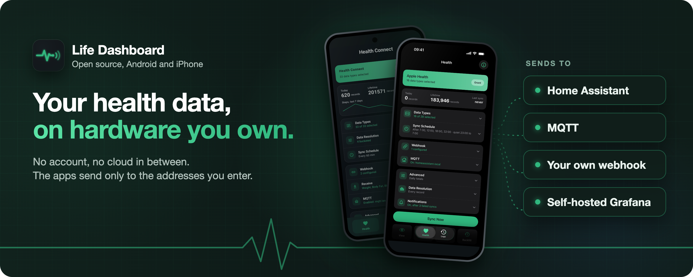

<h1 align="center">Owen Vogelaar</h1>

<b>Platform and automation engineer by trade. I build open-source apps that keep your health data on hardware you own.</b>

  
  
  
  

## Life Dashboard

Health Connect and Apple Health from your phone to Home Assistant, MQTT, your own webhook or a self-hosted Grafana stack. No account, no cloud in between, no analytics.

  
  &nbsp;
  
  &nbsp;
  

| Part | What it does |
|:--|:--|
| **[Android](https://github.com/owen282000/life-dashboard-companion-app)** | Health Connect and screen time per app, from Samsung Health, Fitbit, Garmin, Oura and more. From GitHub, Obtainium or F-Droid. |
| **[iPhone](https://github.com/owen282000/life-dashboard-companion-app-ios)** | Apple Health and your Apple Watch, with the same payload. On the App Store, €6.99 once, no subscription. |
| **[Home Assistant](https://github.com/owen282000/life-dashboard-ha)** | An integration in the default HACS list: pair with one QR code, every day lands in long-term statistics. |
| **[Self-hosted stack](https://github.com/owen282000/life-dashboard-stack)** | Postgres and Grafana with ready-made dashboards, and an MCP server so the AI you choose can read your history. |

  
  
  

**Your data stays yours.** No account, no analytics, no tracking SDKs: the apps send only to the addresses you enter. All four parts are MIT licensed, and every Android release is a reproducible build you can check against the source. I use it on my own phone every day.

Questions, bugs and ideas go to [Discussions](https://github.com/owen282000/life-dashboard-companion-app/discussions). If it helps you, [GitHub Sponsors](https://github.com/sponsors/owen282000) or [Ko-fi](https://ko-fi.com/owen282000) keep it going.

## The day job

Platform and automation engineer: multi-cloud Kubernetes platforms with GitOps (Argo CD), Terraform and OpenTofu, and Vault, automated with Ansible and AWX on Red Hat and SUSE Rancher. The same habits go into Life Dashboard: signed payloads, reproducible builds, CI on every change, and a Helm chart with CloudNativePG for the stack.

Ask me about **Ansible, Kubernetes and AWX**.

## Certifications

**20 certifications** across Red Hat, the CNCF, SUSE and Microsoft, including **Red Hat Certified Architect** in both Enterprise Linux and Ansible. Every badge links to its verification.

| Track | Certifications |
|:--|:--|
| **Red Hat** |      |
| **Red Hat specialist** |       |
| **Kubernetes (CNCF)** |    |
| **SUSE Rancher** |     |
| **Microsoft Azure** |   |

<a href="https://www.credly.com/users/owen-vogelaar/badges">All badges on Credly</a>

 

Apple, the Apple logo and App Store are trademarks of Apple Inc., registered in the U.S. and other countries.

